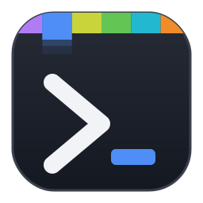

</br>
</br>
</br>

# Switchboard

A Windows Terminal switchboard: name your terminals, give each one a color, see at a glance which ones are working or waiting on you, and jump to any of them from anywhere — without six entries in the taskbar.

<br clear="left" />

## What it does

- **Registry** — a `switchboard.json` of named terminals: profile, shell, working dir, startup command, color, jump key. That file is the whole product state.
- **Edge strip** — an 8 px strip on the top (or left/right) screen edge, one colored segment per terminal. Active one glows; one that wants attention pulses.
- **Colored frames** — the terminal's color is painted onto its Windows Terminal window border (Windows 11) and passed as the tab color, so you always know which window you're looking at.
- **Hotkeys** — `Ctrl+Alt+1…9` jumps, `Ctrl+Alt+N` opens a fresh terminal (auto-named, auto-colored, registered), `Ctrl+Alt+Space` jumps to whichever terminal is waiting on you.
- **Status** — inferred from window titles, taskbar flashes and (later) thumbnail motion. No shell configuration required.

Slide-out rail with live thumbnails and the overlay switcher are milestones 2–3; see [ROADMAP.md](ROADMAP.md).

## Requirements

- Windows 11 (Windows 10 runs, but window frames won't be colored)
- [Windows Terminal](https://aka.ms/terminal) on `PATH` as `wt.exe`
- .NET 8 SDK to build

## Build & run

```powershell
dotnet build
dotnet test
dotnet run --project src/Switchboard.App
```

On first run there is no registry. Copy `docs/switchboard.example.json` to `%APPDATA%\Switchboard\switchboard.json` and edit it, or just press `Ctrl+Alt+N` a few times.

## Layout

```
src/
  Switchboard.Core/      pure logic — registry model, status engine, wt command builder, hotkey chords. No Win32, no WPF.
  Switchboard.Windows/   Win32 interop — DWM frame color, WinEvent window tracker, global hotkeys, focus.
  Switchboard.App/       WPF — composition root, TerminalSession orchestrator, strip window, view models.
tests/
  Switchboard.Core.Tests/  xunit, runs cross-platform.
docs/
  PRD.md, ROADMAP.md, adr/   product, plan, and the decisions behind the shape of the code.
  design/                    the interactive mockups the UI is built from.
assets/
  icon/                      app icon — switchboard.ico is the exe icon, .svg is the source.
```

## How a registry row becomes a window

```
wt -w anvil new-tab -p Ubuntu --title anvil --tabColor #B07CF5 -- wsl.exe -d Ubuntu --cd ~/anvil -- bash -lic "claude --resume; exec bash -l"
```

1. `TerminalSession.LaunchAsync` tells the `WindowTracker` to expect a window titled `anvil`, then runs the command above.
2. The tracker's WinEvent hook sees a new `CASCADIA_HOSTING_WINDOW_CLASS` window whose title is `anvil` and binds the HWND to the name.
3. `FrameColorizer` sets `DWMWA_BORDER_COLOR` on that HWND. From here on the window is tracked by HWND, so the shell is free to change the title, and those title changes feed the `StatusEngine`.

Details and trade-offs are in `docs/adr/`.

## Status

Milestone 1 (strip + colored frames + launch/jump/new hotkeys) is scaffolded end to end. The code has not yet been built on a Windows machine with the .NET SDK — expect a short round of compiler fixes on the first `dotnet build`.
